# I2 Air-Quality Project - code explanation

## Project overview

A school air-quality system made of two ESP32 units that communicate through the ThingSpeak cloud:

1. **Sensor unit** - measures PM2.5 / PM10 (PMS5003T sensor), temperature, humidity and (optionally) the A-weighted sound level (INMP441 microphone) and uploads the values to ThingSpeak.
2. **Matrix display unit** - reads the latest values from ThingSpeak and shows them as scrolling coloured text on a NeoPixel matrix.

The first generation ran as a classic *super-loop* (one big `loop()`). This version is built on **FreeRTOS**: every job is a separate task with its own priority, and the tasks exchange data through queues and mutexes. Benefits: the slow network operations cannot block the time-critical ones, timing can be measured per task, and new features (sound level meter) can be added without disturbing the existing flow.

Other improvements in this version: settings stored safely in flash, a WiFi connection supervisor with automatic recovery, a protected configuration portal, a serial console, remote calibration through ThingSpeak, and built-in timing / CPU-load measurement tools.

## Repository layout

- `libraries/I2Common/` - shared library (settings, WiFi, console, timing tools)
- `PMS_Sensor_RTOS/` - sensor unit (PMS5003T + INMP441 sound level meter + OLED)
- `Matrix_Display_RTOS/` - matrix display unit
- `CODE_EXPLAINED.md` - this document

Diagrams are Mermaid (they render in the VS Code / GitHub Markdown preview; export to PNG/SVG for Word).

---

## 1. The big picture

### 1.1 System block diagram

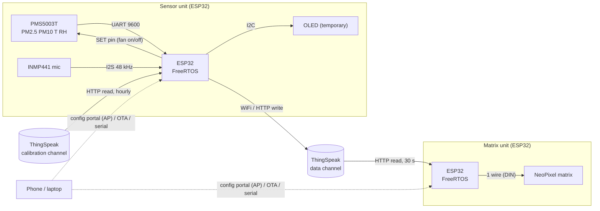

### 1.2 Software layers

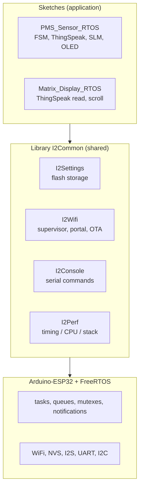

### 1.3 Tasks (the RTOS design)

Higher priority number = more urgent. Task stack sizes are in bytes.

| Task | Unit | Priority | Core (ESP32) | Period / trigger | Job |
|---|---|---|---|---|---|
| `slm_reader` | sensor | 4 | 1 | every 125 ms (I2S block) | read mic block, filter, produce 2 sums |
| `pms_fsm` | sensor | 3 | 0 | 50 ms | state machine + UART parsing; feeds the internal task watchdog |
| `thingspeak` | sensor | 2 | 0 | queue / 1 s poll | upload, retries, calibration check |
| `slm_calc` | sensor | 2 | 1 | per block | dB, Leq, FFT |
| `wifiTask` | both | 2 | 0 | 100 ms | connection supervisor, OTA, portal |
| `display` | sensor | 1 | 0 | 250 ms | OLED |
| `led` | sensor | 1 | 0 | 250 / 500 ms | status LED |
| `console` | both | 1 | 0 | 50 ms | serial commands |
| `perfSampler` | both (on demand) | 5 | any | 1 s | CPU-load sampling |
| `ts_read` | matrix | 2 | 0 | 30 s | read ThingSpeak |
| `display` | matrix | 3 | 1 | 60 ms | scrolling text |

Design rule (rate-monotonic idea): the most time-critical work gets the highest priority. The I2S block must never be late, so it is highest. The ThingSpeak HTTP request blocks for seconds, so it is below the FSM.

### 1.4 How tasks talk to each other (RTOS objects used)

| Object | Where | Why |
|---|---|---|
| **Queue** `g_tsQ` (length 4) | FSM -> thingspeak task | the FSM never waits for the network |
| **Queue** `s_q` (length 8) | slm_reader -> slm_calc | decouples fast filtering from the dB maths |
| **Queue** `s_dataQ` (length 1, `xQueueOverwrite`) | matrix ts_read -> display | the display always gets the newest reading |
| **Mutex** | latest sample, settings, SLM window | protect data that two tasks touch |
| **Task notification** | settings changed -> FSM | wakes a sleeping task without polling |
| **volatile flags** | state, heartbeat, OTA percent | simple one-writer / many-reader values |

---

## 2. Configuration portal and access code

### 2.1 The portal page

The portal is the **WiFiManager configuration page**. It is a small web page that the ESP32 itself serves while it runs its own WiFi access point (AP).

How to reach it:
1. The ESP32 starts an access point named **`AqsAP-WiFi`** (password `FEIT_KHIE_AP`, configurable in `i2_secrets.h`).
2. Connect a phone to that WiFi network.
3. The phone opens the page automatically (captive portal), or open `192.168.4.1` in a browser.
4. The page shows a list of nearby networks, a password box, and the extra fields (ThingSpeak channel ID, write/read key, fast-mode checkbox, access code).

The ESP32 opens this AP only when it is needed:
- **Automatically**: the unit has been without WiFi for more than 60 s (at most once per 15 minutes).
- **On demand**: type `portal` in the serial monitor (after `login`).
- It stays open for **3 minutes**, then closes by itself.

### 2.2 The access code

The access code is a general password that decides who may change parameters.

- It is the same code as the serial `login <code>` code. Factory default is `KHIE-2026` (in `i2_secrets.h`). It is stored in flash and changed with the serial command `passwd`.
- It is an extra field at the top of the portal page: **"Access code (required)"**.
- A person who only knows the AP password could connect to the AP, but **cannot change anything** without the access code.

What the code does on the portal (function `runPortal()` in `I2Wifi.cpp`):

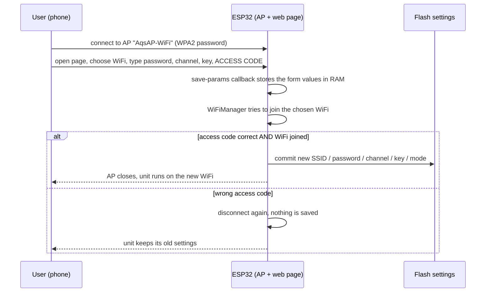

Protection layers (this answers the "someone connected to the AP and entered wrong data" case):
1. The AP is closed during normal operation.
2. The AP is WPA2-protected and closes after 3 minutes.
3. Nothing is stored without the correct access code.

**To verify on hardware:** that the installed WiFiManager version calls the save-params callback when the main WiFi form is submitted (the previous version of the project used the same callback). If it does not, the portal would join the WiFi but not save anything.

---

## 3. Library `I2Common` (shared by both sketches)

### 3.1 `i2_secrets.h` - factory values (needed)

Plain `#define`s: default WiFi (`I2_DEFAULT_WIFI_*`), service/hotspot WiFi (`I2_SERVICE_WIFI_*`), portal AP name + password (`I2_AP_*`), OTA password, default access code. They are used only until you change them from the console/portal. Never publish this file.

### 3.2 `I2Task.h` - core helper (needed)

- `I2_NUM_CORES` is 2 on the ESP32 and 1 on S2/C3.
- `i2Core(core)` returns a valid core: on single-core chips always 0. This is why the same code runs on the ESP32 NodeMCU and the ESP32-S2 mini.
- Declares `i2CreateTask(fn, name, stackBytes, arg, priority, handleOut, core)`: creates a pinned task and registers it for the `perf` report.
- Declares the internal watchdog helpers: `i2WdtInit(timeoutS)` (a timeout resets the chip, idle tasks of all cores are watched), `i2WdtAddSelf()` (the calling task subscribes) and `i2WdtFeed()` (must be called more often than the timeout).

### 3.3 `I2Settings.h/.cpp` - settings in flash (needed)

**Why:** replaces the EEPROM code. Survives reset/power-loss better and can hold many values.

**The struct `I2Settings`** (one block in flash):

| Field | Meaning |
|---|---|
| `magic`, `version`, `size`, `crc` | detect an empty / old / damaged block |
| `ssid`, `wifiPass` | configured WiFi |
| `channelId` | ThingSpeak channel (stored as a number, 6-8 digits accepted) |
| `writeKey` / `readKey` | sensor writes / matrix reads |
| `cfgChannelId`, `cfgReadKey` | optional calibration channel |
| `accessCode` | the access code (serial + portal) |
| `fastMode`, `sleepSec` | measuring mode and sleep time |
| `calAuto`, `calVersion`, `pm25/pm10/temp/humid` | calibration (gain, offset) and version in use |
| `slmOffsetDb` | microphone calibration offset |

**`I2Defaults`** - factory values handed in by the sketch (a library `.cpp` cannot see macros of the sketch).

**Functions**

| Function | What it does |
|---|---|
| `i2cfgBegin(defaults)` | opens flash storage, reads slot A and slot B, picks the first valid, repairs a damaged one, or writes factory defaults on first boot |
| `i2cfgSnapshot(out)` | thread-safe copy of the settings (take a copy, read from the copy) |
| `i2cfgCommit(new)` | stamp magic/version/size/CRC, skip if nothing changed, write slot A, read back and compare, write slot B, read back and compare |
| `i2cfgFactoryReset()` | commit the factory defaults |
| `i2cfgFastMode/SleepSec/SlmOffsetDb/GetCal` | fast getters for values the tasks read often |
| `i2cfgApplyCal(version, cal[4])` | store a new calibration set |
| `i2cfgCheckAccessCode(code)` | constant-time compare (used by the portal) |
| `i2ValidChannelId` | 6-8 digits, no leading zero |
| `i2ValidApiKey` | exactly 16 letters/digits |
| `i2CalParseCsv` | parses `version,g25,o25,g10,o10,gT,oT,gH,oH` and rejects insane values (gain 0.1..10, offset +-500) |
| `i2CalApply(c, raw)` | `gain * raw + offset` |

**Flash-write protection:**

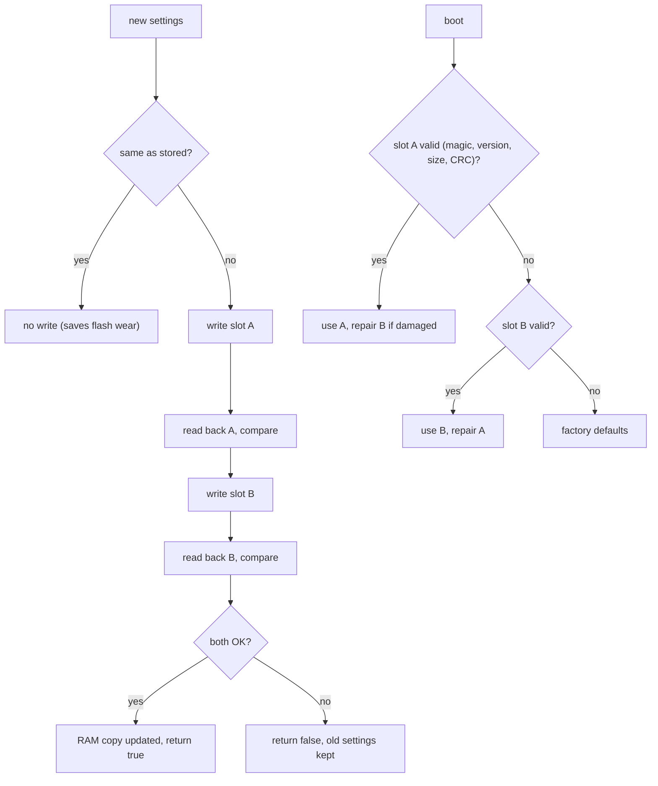

Why it is safe: flash storage (NVS) writes a new entry and invalidates the old one afterwards, so a reset leaves the old or the new value. The two slots, CRC and read-back add a second line of defence. Total power loss cannot be made 100 % safe; this makes it very unlikely to end with garbage, and a damaged block always falls back to a good copy or the defaults.

### 3.4 `I2Wifi.h/.cpp` - WiFi supervisor, portal, OTA (needed)

One task (`wifiTask`) owns the whole WiFi connection. Other tasks only ask `i2wifiConnected()`.

| Function | What it does |
|---|---|
| `connectTo(ssid, pass)` | one attempt. Waits up to 20 s but gives up after 6 s if the status says "SSID not found" or "failed" (wrong password) |
| `runPortal()` | opens the AP + web page, collects the values, checks the access code, saves (see section 2) |
| `portalSaveCb()` | callback from WiFiManager: copies the submitted form values into RAM |
| `otaSetup()` / `otaStart()` | configures ArduinoOTA (hostname, password, progress callbacks) and (re)starts it after every new connection |
| `wifiTask()` | the loop in the flowchart above |
| `i2wifiBegin()` | sets WiFi options (no auto-reconnect, no power save, station mode) and creates the task |
| `i2wifiRequestPortal()` | sets a flag; the task opens the portal on its next pass |
| `i2wifiConnected / OnServiceNet / DownMs / PrintStatus` | status for other tasks and `status` command |
| `g_i2OtaPercent` | OTA progress (-1 idle, 0..100, -2 error) read by the display |

Why `WiFi.setAutoReconnect(false)`: the supervisor handles reconnection itself; two reconnect mechanisms would fight each other. That conflict is a likely cause of the old matrix "Connecting.." hang.

### 3.5 `I2Console.h/.cpp` - serial command line (needed for setup, optional for the rest)

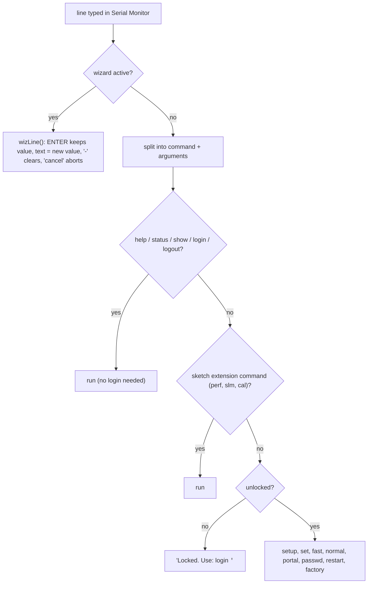

Parts:
- **Field table `FIELDS[]`**: one row per setting (key, label, which units use it, secret or not). `show`, `set` and the wizard all use this one table, so a new setting is added in one place.
- **`fieldGet` / `fieldSet`**: print a value (secrets masked) / validate and store a new value.
- **Authentication**: `login` unlocks for 5 minutes; 3 wrong codes lock for 30 s; compare is constant-time.
- **Wizard**: `wizStart / wizNext / wizPrompt / wizLine`. Shows the current value for every setting; at the end a summary and "Save and restart? (y/N)".
- **Line reader `consoleTask`**: handles CR, LF and CRLF as one line end, backspace, 128-character limit, wizard timeout after 120 s.
- **`i2consoleBegin(ext, help, statusHook, changedHook)`**: the sketch plugs in its own commands, extra lines for `status`, and a function called after settings change.

### 3.6 `I2Perf.h/.cpp` - timing and load tools (needed for real-time analysis)

| Tool | How it works | What it answers |
|---|---|---|
| `PerfProbe` + `perfRecord` / `PerfScope` | measures a code section with the microsecond timer; keeps count, last, min, max, total, and counts runs longer than a budget | "How long does the FFT / filter block / HTTP take?" (max = worst case) |
| `PerfCounter` | simple event counter | "How many blocks were dropped? How many uploads failed?" |
| CPU load (`perfBegin`, `perfCpuEnable`) | counts how often the idle task runs (idle hook). At boot it measures the idle rate = 0 % load; later load = 1 - rate/baseline. A 1 s sampler keeps current, average and peak | "How busy is each core?" |
| task table | `uxTaskGetStackHighWaterMark` = smallest free stack ever | "Is a stack close to overflowing?" |
| heap | free, minimum ever free, largest block | "Is memory running out?" |
| `perfLoadStart` | a task that burns pct % of a core in 100 ms periods | "At what load does the system start missing deadlines?" |
| `i2CreateTask` | creates and registers tasks | needed for the task table |

---

## 4. Sensor sketch `PMS_Sensor_RTOS/`

### 4.1 `app_config.h` - all constants (needed)

Feature switches (`ENABLE_SLM`, `SLM_ENABLE_FFT`, `ENABLE_OLED`, `TEST_SINGLE_CORE`), pins, FSM times (`PMS_WARMUP_MS` 30 s, `PMS_MEASURE_MS` 30 s, `PMS_SLEEP_DEFAULT_S` 240, `PMS_FAST_WINDOW_MS` 60 s), LED periods (250 / 500 ms), ThingSpeak limits, priorities, core assignment, default calibration, default channel.

`TEST_SINGLE_CORE 1` puts every task on core 0 so the ESP32 NodeMCU behaves like the single-core S2 mini - used for the load experiments.

### 4.2 `app_state.h/.cpp` - shared data (needed)

- `PmsSample` (calibrated values), `TsMsg` (average + sound values sent to the upload task).
- Globals: `g_pmsState`, `g_stateStartMs`, `g_stateDurMs` (for "seconds left" on the OLED), `g_pmsHeartbeat` (FSM alive counter), `g_tsQ`, `g_tsLastStatus`, `g_tsLastOkMs`.
- `appLatestSet/Get`: the most recent sample behind a mutex (OLED reads it).
- Probes and counters for the perf report.

### 4.3 `pms5003t.h/.cpp` - frame parser (needed)

`PmsParser::feed(byte)` is called for every received byte:
1. wait for `0x42`, then `0x4D`
2. collect 32 bytes
3. check frame length (28) and checksum (sum of first 30 bytes)
4. decode PM2.5, PM10 (atmospheric or CF=1, `PMS_USE_ATMOSPHERIC`), temperature (signed, /10), humidity (/10)

It never blocks. A bad frame only increments a counter and the parser re-synchronises.

### 4.4 `task_pms.cpp` - the state machine (needed)

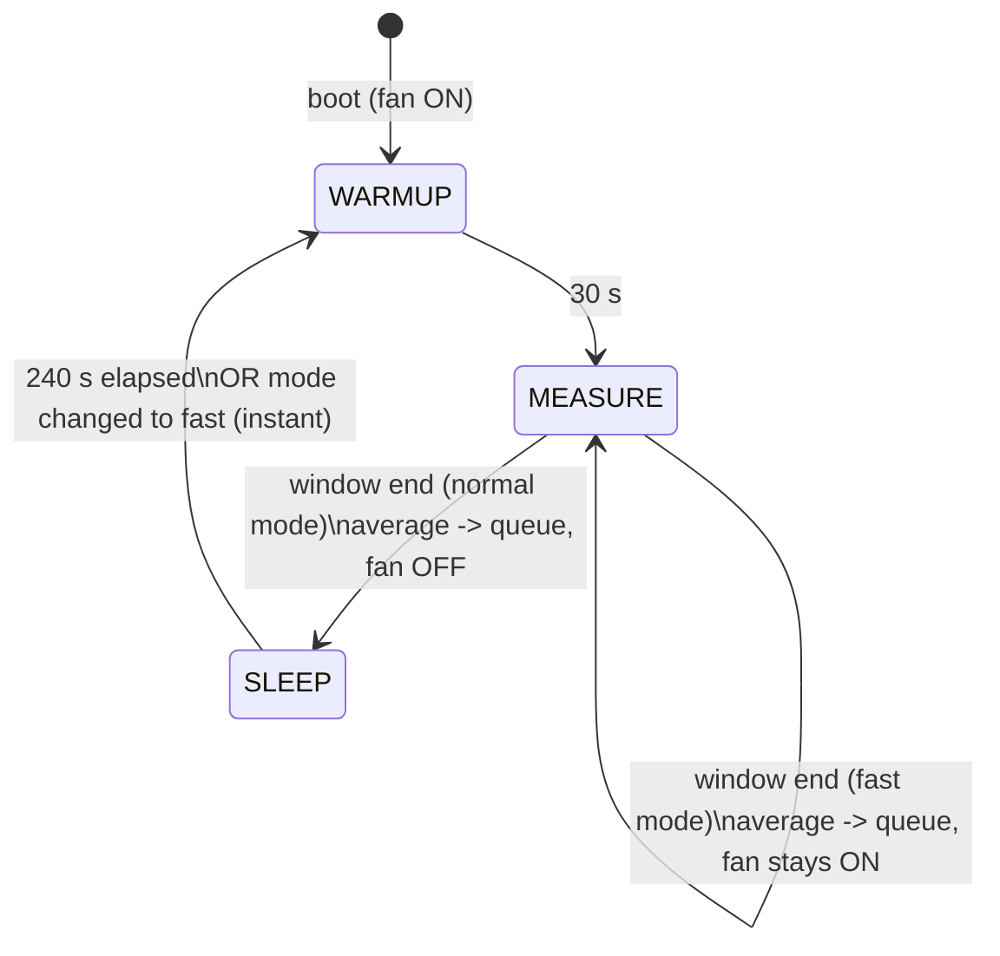

Each loop (every 50 ms):
1. Wait on the task notification with a 50 ms timeout (this is both the loop delay and the wake-up on "settings changed"). The lateness of that wake-up is recorded as scheduling jitter.
2. Increment the heartbeat, feed the internal task watchdog (`i2WdtFeed`).
3. Read the mode and sleep time (they may have changed).
4. Unless sleeping, read all UART bytes into the parser. In MEASURE each good frame is **calibrated** (`gain*x+offset`), added to the sums and stored as "latest".
5. State logic as in the diagram. At the end of a MEASURE window `finishWindow()` averages, adds the sound level window (`slmTakeWindow`), and puts a `TsMsg` in the queue (if full: count a drop).

Normal cycle = 30 + 30 + 240 = 300 s per upload.

### 4.5 `task_thingspeak.cpp` - network + remote calibration (needed)

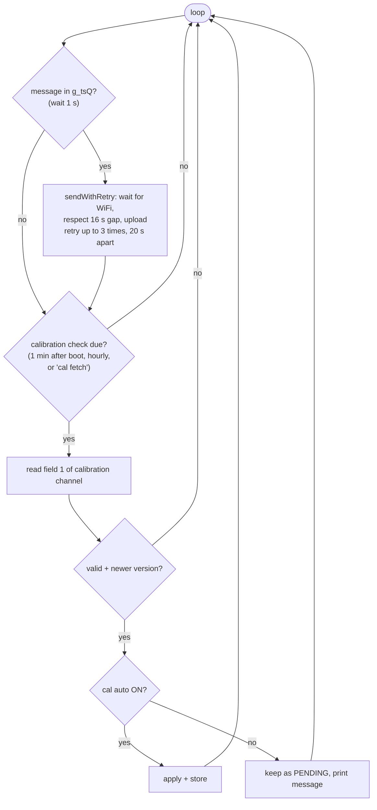

ThingSpeak fields: 1 PM2.5, 2 PM10, 3 temperature, 4 humidity, 5 LAeq, 6 LAmax.
Calibration channel field 1 text: `version,g25,o25,g10,o10,gT,oT,gH,oH`, for example `2,1.05,-1.2,1.02,0,1,-0.5,1,2`.
Operator flow: `cal` (show active + pending) -> `cal accept` or `cal reject`.

### 4.6 `sound_level.h/.cpp` + `sos-iir-filter.h` - sound level meter (optional feature)

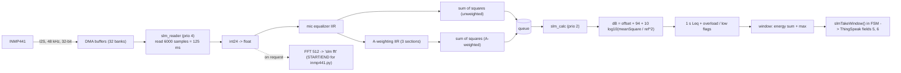

Key points:
- Why two tasks: the reader must keep up with the microphone (hard deadline every 125 ms) and does only filtering; logs and dB maths run in the lower priority task.
- `10*log10(mean square)` equals `20*log10(RMS)`: the same result, one square root less.
- Levels are averaged as **energy** (10^(L/10)), never by averaging dB values.
- Overload seconds (above 120 dB) are excluded from the upload average and counted.
- `sos-iir-filter.h`: Kostoski's filter. Assembly for the classic ESP32; plain C++ for other chips (S2 has no FPU, so it is slow there).
- Probes: `slm_block` (budget = 125000 us), `slm_calc`, `slm_fft`; counter `slm_block_dropped` (calc task not keeping up).

### 4.7 `task_display.cpp`, `task_misc.cpp`

- OLED task (temporary): state + seconds left, mode, PM, T/H, noise, WiFi/TS status, OTA progress bar. Frame time recorded as probe `oled_frame`.
- LED task: toggles every 250 ms (fast) / 500 ms (normal).

### 4.8 `sensor_console.cpp` - sensor commands

`perf` (report, reset, cpu on/off, load), `slm` (status, on/off, fft, ref), `cal` (show, fetch, accept, reject, auto). Also adds FSM/ThingSpeak/SLM lines to `status` and wakes the FSM when settings change.

### 4.9 `PMS_Sensor_RTOS.ino` - start-up order

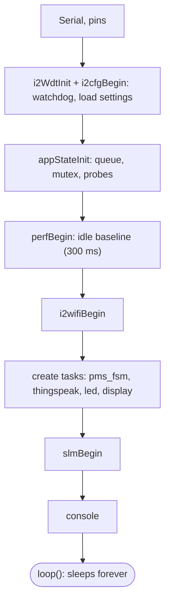

---

## 5. Matrix sketch `Matrix_Display_RTOS/`

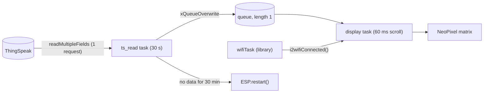

- `ts_read`: reads fields 1-5 in one HTTP request, rounds to integers, puts them in the queue. On failure retries after 10 s and restarts the unit if nothing worked for 30 minutes.
- `display`: shows "Connecting.." while WiFi is down. When new data arrives while a message is scrolling, it waits until the message has scrolled out, then switches. Text is drawn in coloured segments (colour by value); the message width is computed from the text actually drawn.
- Colour thresholds: unchanged from the previous version; noise added (<55 green, <70 yellow, <85 orange, else red).

---

## 6. Typical flows (for the report)

### 6.1 Calibration after a sensor replacement

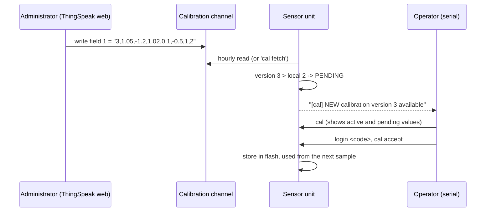

### 6.2 Changing parameters

| Way | When | Needs access code |
|---|---|---|
| Serial `setup` wizard / `set key value` | cable connected | yes (`login`) |
| Config portal (AP page) | WiFi lost or `portal` command | yes (field on the page) |
| ThingSpeak calibration channel | calibration only | confirmation (`cal accept`) unless `cal auto on` |
| OTA | firmware update | OTA password |

---

## 7. What is needed and what is optional

| Part | Needed? | If removed |
|---|---|---|
| `I2Settings` | yes | no stored parameters |
| `I2Wifi` (supervisor + OTA) | yes | no connection management |
| config portal inside `I2Wifi` | optional (deployment choice) | serial setup + service network still work |
| service (hotspot) network | optional | one `if` block in `wifiTask` |
| `I2Console` | optional but recommended | no serial setup, no `perf` |
| `I2Perf` | needed for timing analysis | no measurements (also remove probe calls) |
| `sound_level.*`, `sos-iir-filter.h` | optional (`ENABLE_SLM 0`) | PMS only |
| `task_display.cpp` | temporary | final product uses the matrix |
| internal watchdog (`i2WdtInit`) | yes (no external parts) | no automatic reset of a frozen task |

## 8. To verify on real hardware

1. PMS5003T frame offsets (temperature / humidity / PM type) against the original `PMS5003T.h` / datasheet.
2. WiFiManager save callback saves the portal values (section 2).
3. Build with the installed library versions (ThingSpeak, arduinoFFT, Adafruit libraries, WiFiManager).
4. `perf` numbers on the ESP32 (2 cores) and with `TEST_SINGLE_CORE 1` (S2-like).

A step-by-step procedure for all of this is in section 9.

---

## 9. Bench testing guide

A complete test of every feature is possible with the minimum bench set-up below. No school hardware is needed.

### 9.1 Bench set-up

| Item | Connection |
|---|---|
| ESP32 dev board (sensor unit) | USB to PC, Serial Monitor **115200 baud**, line ending **Newline** (or *Both NL & CR*) |
| PMS5003T | PMS TX -> GPIO16, PMS RX -> GPIO17, SET -> GPIO4, 5 V + GND |
| OLED SSD1306 (I2C) | SDA GPIO21, SCL GPIO22, 3.3 V, address 0x3C |
| INMP441 (optional) | VDD 3.3 V, GND, SCK -> GPIO32, WS -> GPIO5, SD -> GPIO33, **L/R -> GND** |
| Second ESP32 (matrix unit) | DIN -> GPIO5 (of that board), matrix powered from a suitable 5 V supply |
| Phone | used as the service hotspot, for the config portal and for a reference sound-level app |
| ThingSpeak | one data channel (fields 1-6); optionally a second channel for calibration |

Preparation:
1. Install the libraries: ThingSpeak, WiFiManager, Adafruit SSD1306, Adafruit GFX, Adafruit NeoMatrix, Adafruit NeoPixel, arduinoFFT.
2. Copy `libraries/I2Common` into `Documents/Arduino/libraries`.
3. Edit `libraries/I2Common/src/i2_secrets.h` (WiFi, service hotspot, OTA password, access code) and the ThingSpeak channel/keys in the two `app_config.h` files.
4. Board: *ESP32 Dev Module*, default partition scheme (OTA needs two app partitions).
5. For the first tests use the shortest cycle: after boot type `login <code>` and `set sleep 30`.

Useful commands during all tests: `help`, `status`, `show`, `perf`.

### 9.2 Test list

| # | Test | Steps | Expected result |
|---|---|---|---|
| 1 | Boot | Flash the sensor sketch, open the monitor | `[cfg] no valid settings ... factory defaults` (first boot only), `[perf] idle baseline ...`, `[wifi] connected ...`, `Setup done`. `status` shows firmware, uptime, reset reason, WiFi, FSM |
| 2 | Console lock | `set channel 3095045` | `Locked. Use: login <code>` |
| 3 | Login + validation | `login <code>`, then `set channel 12345` (5 digits), `set channel 123456` (6 digits), `set wkey ABC` | 5 digits rejected, 6 digits accepted, short key rejected |
| 4 | Setup wizard | `setup`, press ENTER on every question, `y` at the end | Current value shown for every parameter, nothing changes, unit restarts |
| 5 | Persistence | change a value with `set`, press the board RESET button, then `show` | Value is still there; `status` says *settings from flash: yes* |
| 6 | Wrong code lock | `login wrong` three times | 30 s lockout message |
| 7 | FSM timing | watch the log with timestamps enabled | `WARMUP (30 s)` -> `MEASURE (30 s)` with one `sample` line per second -> `average of N samples` -> `SLEEP (240 s)` -> `WARMUP` |
| 8 | Sensor reaction | during MEASURE blow smoke / incense / breath at the PMS | PM values rise, OLED follows; humidity rises with breath |
| 9 | Fast mode | `fast` while in SLEEP | SLEEP ends immediately, WARMUP starts, afterwards MEASURE repeats every 60 s without sleep; LED blinks faster (250 ms) |
| 10 | Back to normal | `normal` | after the current window the unit goes to SLEEP again; LED 500 ms |
| 11 | ThingSpeak upload | wait for one average | `[ts] upload OK`; values appear in fields 1-4 (5-6 with the microphone) |
| 12 | Upload failure | `set wkey AAAAAAAAAAAAAAAA` (valid format, wrong key) | `upload failed, HTTP ...`, three tries 20 s apart, then `giving up`; `perf` counter `ts_upload_failed` increases. Restore the real key |
| 13 | Sensor unplugged | disconnect the PMS TX wire | `no valid frames in this window`; counter `pms_empty_windows` |
| 14 | WiFi loss | switch the router off | `link lost`, repeated connect attempts; when the router returns the unit reconnects by itself |
| 15 | Service network | create a phone hotspot with the service SSID/password, then switch the router off | unit joins the hotspot; `status` shows *(SERVICE net)* |
| 16 | Config portal | with neither network available wait > 60 s (or type `portal`) | AP `AqsAP-WiFi` appears; connect with the phone, open `192.168.4.1` |
| 17 | Portal access code | submit the form once with a wrong and once with the right access code | wrong: `WRONG access code - nothing saved`; right: `settings saved` and the unit uses the new WiFi |
| 18 | Long outage | keep all networks off for > 10 min | `down too long - restarting ESP32`; the unit boots and keeps trying |
| 19 | OTA | with the unit on the network choose the network port in Arduino IDE and upload | OLED shows the OTA progress bar, unit reboots with the new firmware. Wrong OTA password is refused |
| 20 | Remote calibration | see 9.3 | pending message, accept, values change |
| 21 | Matrix unit | see 9.4 | scrolling text with coloured values |
| 22 | Sound level | see 9.5 | LAeq follows the room noise |
| 23 | Performance | see 9.6 | table of timings, CPU load, stack and heap |

### 9.3 Remote calibration test

1. Create a second ThingSpeak channel (it may be private) and note its channel ID, read key and write key.
2. On the unit: `login <code>`, `set cfgch <channel id>`, `set cfgkey <read key>` (use `-` for a public channel).
3. Write a calibration set from any browser (format `version,g25,o25,g10,o10,gT,oT,gH,oH`):
   `https://api.thingspeak.com/update?api_key=<WRITE_KEY>&field1=2,1.10,0,1.00,0,1,-1.5,1,3`
4. Type `cal fetch`. Expected: `NEW calibration version 2 available`.
5. `cal` shows the active and the pending values. `cal accept` stores them (login required). From the next sample PM2.5 is 10 % higher, temperature 1.5 lower, humidity 3 higher.
6. `cal reject` (with a new version 3) refuses it; it is not offered again until version 4.
7. `cal auto on`, write version 4: it is applied without asking.
8. Write an older version (1) or a broken string (`gain 50`): ignored with a message.

### 9.4 Matrix unit test

1. Flash `Matrix_Display_RTOS` to the second ESP32 and set the same channel and a read key with `login`, `set channel`, `set rkey`.
2. Expected: `Connecting..` while WiFi is down, then the scrolling message `KHIE @ FEIT Vozduh: T:..C H:..% PM2.5:.. PM10:..`.
3. To test colours without waiting for the sensor, write values by URL (`...update?api_key=<WRITE_KEY>&field1=80&field2=120&field3=35&field4=70&field5=90`): PM2.5/PM10 red, temperature red, humidity orange, noise red.
4. New data arriving while a message scrolls is shown only after the message ends.
5. Recovery: switch the router off for a few minutes and back on - the text must return without a manual reset. After 10 minutes without WiFi the unit restarts itself.
6. `perf` shows `matrix_frame` (frame time against the 60 ms scroll period) and `ts_read_http`.

### 9.5 Sound level meter test

1. Wire the INMP441 (section 9.1). `slm` must show `running` and a changing LAeq.
2. Typical indoor values: quiet room about 30-45 dBA, normal speech 55-65 dBA, a clap above 80 dBA.
3. Compare with a sound-level app on a phone for a rough check (phone microphones are not accurate).
4. Proper calibration needs a 94 dB / 1 kHz acoustic calibrator: put it on the microphone and type `slm ref 94` (login required). The correction is stored in flash (`set slmoff` sets it directly).
5. `slm fft` prints one spectrum in START/END format; the `inmp441.py` script can plot it (the bin width is 48000/512 = 93.75 Hz).
6. `slm off` / `slm on` stop and start the microphone processing; the PM cycle must continue unaffected.

### 9.6 Performance and real-time test

Procedure (repeat for each configuration and write the numbers into a table):
1. `perf reset`, then `perf cpu on`, wait 60 s, then `perf`.
2. Read: CPU load per core (now / average / **peak**), the probe table (`slm_block`, `slm_calc`, `pms_loop_body`, `pms_wake_late`, `oled_frame`, `ts_http`), the stack column and the heap line.

Configurations to compare:

| Config | How |
|---|---|
| A: PMS only | `ENABLE_SLM 0` |
| B: PMS + SLM, 2 cores | defaults |
| C: PMS + SLM on one core (S2-like) | `TEST_SINGLE_CORE 1` |

Overload experiment (generator = `perf load <pct> <prio> <core> <seconds>`):
- Raise the load step by step: 30, 50, 70, 90 % at priority 1, then at priority 5, on the core that runs the SLM.
- After each step read `perf`.

How to interpret:

| Observation | Meaning |
|---|---|
| `slm_block` max below its budget (125000 us) | the filter chain finishes within one block period |
| `slm_block` overruns > 0 | **deadline missed**; the I2S input can overflow |
| `slm_block_dropped` > 0 | the calc task cannot keep up, data lost |
| `pms_wake_late` max grows | scheduling jitter of the state machine under load |
| stack free < 300 bytes | stack overflow danger: enlarge the stack in `i2CreateTask` |
| heap minimum very low | memory problem |
| WiFi drops during very high load | the high-priority load task starves the network task |

Possible measures if the limit is reached: lower the priority of non-critical tasks, put the SLM on its own core, process in time slices, reduce work per block (fewer filter sections, fixed point), lower the CPU load of the FFT by running it only on demand.

### 9.7 Before deploying a unit in a school

- `normal` mode (fast mode is stored in flash and survives a reset!) and sleep 240 s (`show`).
- Access code, OTA password and AP password changed from the factory values.
- `status`: WiFi connected, ThingSpeak upload OK, no pending calibration, `reset reason` = power-on.
- `ENABLE_SLM 0` if the unit has no microphone; `ENABLE_OLED 0` if it has no OLED.
- Real `i2_secrets.h` kept out of version control.

### 9.8 Troubleshooting

| Symptom | Check |
|---|---|
| `no valid frames` | TX/RX crossed, SET pin, 5 V supply of the PMS, baud 9600 |
| PM values look wrong | frame offsets / atmospheric vs CF=1 (`PMS_USE_ATMOSPHERIC`) |
| OLED stays black | address (0x3C / 0x3D), wiring, `oled init failed` message |
| No network port for OTA | unit and PC on the same network, firewall, OTA password |
| `i2s` errors or LAeq constant | microphone wiring, L/R pin to GND, pin numbers in `app_config.h` |
| Console ignores input | line ending must be Newline or Both NL & CR |
| Portal does not save | WiFiManager version / save callback (section 2) |

---

## 10. Frequently asked questions

**Why FreeRTOS instead of a super-loop?**
In a super-loop every action waits for the previous one: a slow HTTP request delays the sensor reading and the display. With tasks each job has its own period and priority; the scheduler interrupts a low-priority job when a high-priority one is ready. Timing becomes measurable (section 3.6) and the system degrades in a controlled way.

**Why are settings in flash (NVS) and not EEPROM?**
NVS is wear-levelled and checks every entry. In addition the whole settings block is stored twice with a CRC, verified after writing, and skipped when unchanged (section 3.3).

**What protects against a reset during a flash write?**
The write is staged (slot A, then slot B), both are verified, and boot falls back to a valid slot or the factory defaults. The ESP32 brownout detector resets the chip when the supply voltage collapses, before the flash becomes unreliable. The firmware reports the last reset reason (`status`), which shows whether a restart came from a watchdog, a crash or a brownout.

**Is an external watchdog needed?**
No. The ESP32 has internal watchdogs (task watchdog, interrupt watchdog, RTC/system watchdog) and a brownout detector. The task watchdog is configured so that a timeout resets the chip (`i2WdtInit`, 10 s); the state machine of the sensor unit and the display task of the matrix unit feed it in every loop, and the idle tasks of all cores are watched as well. An external circuit (for example a 555) would only add protection against a failure of the chip or its supply and is not required.

**Why is there both a config portal and a serial console?**
The portal allows changing the WiFi on site with a phone, without a cable. The serial console is for installation, diagnostics and testing. Both are protected by the same access code.

**Is the AP a security risk?**
It is closed in normal operation, opens only when the link is lost (or on command), is WPA2-protected, closes after 3 minutes, and nothing is saved without the access code.

**What is the service network for?**
A fallback WiFi (a phone hotspot) with a factory name and password, so that firmware can always be updated over the air even when the school network is unavailable.

**Why does the state machine sleep and what is fast mode?**
Normal mode is 30 s warm-up, 30 s measuring, 240 s sleep with the sensor fan off: longer sensor life and a 5-minute upload period. Fast mode skips the sleep (sensor stays on) and uploads every 60 s; it is meant for testing and demonstrations, production runs in normal mode.

**Why is calibration stored on ThingSpeak and not in the firmware?**
Replacing a sensor must not require a new firmware. The coefficients are in a flash-stored set (gain and offset per quantity) that can be updated remotely through a calibration channel and is applied only after confirmation (or automatically if enabled).

**Why `10*log10` of the mean square and not `20*log10` of the RMS?**
They give the same number. Power is proportional to the square of the amplitude, so `20*log10(RMS) = 10*log10(RMS^2)`. The mean-square form needs one square root less.

**Why are sound levels averaged as energy?**
Decibels are logarithmic: averaging dB values underestimates the true level. The code converts to energy (`10^(L/10)`), averages, and converts back.

**Can the ESP32-S2 mini run the sound level meter?**
It has one core and no floating-point unit, so the filter chain runs in software and takes much more time. Use the timing tools (configuration C in section 9.6) to measure whether it fits into the 125 ms block budget together with the rest of the system.

**Which tools exist in FreeRTOS to watch the load?**
Stack high-water mark per task, run-time statistics (needs a special build option) and the idle-hook method used here, plus hardware tools such as SEGGER SystemView / Percepio Tracealyzer and a GPIO toggled around the critical code and watched on a logic analyser or oscilloscope.
