# I2 air quality monitor - code description

## Overview

The project is a small air quality system for schools. It has two ESP32 units that exchange data through ThingSpeak:

- **Sensor unit** - measures PM2.5, PM10, temperature and humidity with a PMS5003T sensor, optionally the noise level with an INMP441 microphone, and uploads the values to ThingSpeak.
- **Matrix display unit** - reads the latest values from ThingSpeak and shows them as scrolling coloured text on a WS2812B LED matrix.

The first version was a super-loop (everything in one `loop()`). This version uses FreeRTOS: every job is a task with its own priority, and the tasks exchange data through queues and mutexes. A slow network request can no longer block the sensor reading or the scrolling.

Repository layout:

- `libraries/I2Common/` - shared library (settings, WiFi, console, timing tools)
- `PMS_Sensor_RTOS/` - sensor unit
- `Matrix_Display_RTOS/` - matrix display unit
- `docs/` - Word reports and figures

The diagrams are Mermaid and show up in the VS Code or GitHub preview.

### System

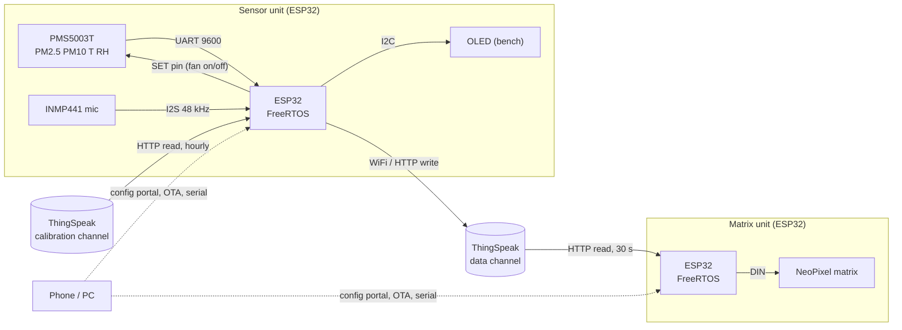

### Software layers

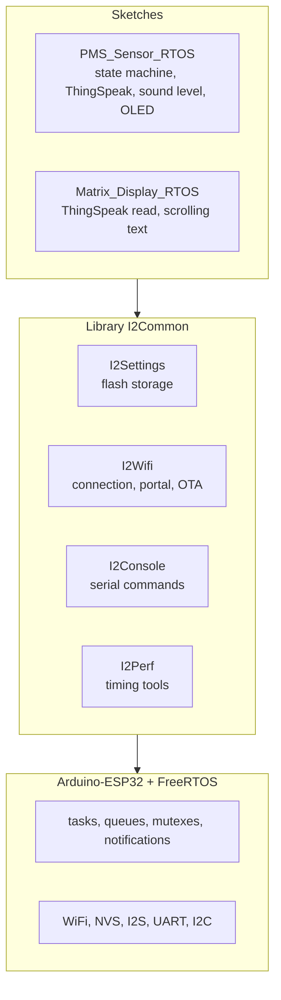

### Tasks

A higher priority number means a higher priority.

| Task | Unit | Prio | Core | Period | Job |
|---|---|---|---|---|---|
| `slm_reader` | sensor | 4 | 1 | 125 ms (I2S block) | reads the microphone block and filters it |
| `pms_fsm` | sensor | 3 | 0 | 50 ms | state machine, UART parsing |
| `thingspeak` | sensor | 2 | 0 | queue | upload, retries, calibration check |
| `slm_calc` | sensor | 2 | 1 | per block | dB values, Leq, FFT |
| `wifiTask` | both | 2 | 0 | 100 ms | connection, OTA, portal |
| `display`, `led` | sensor | 1 | 0 | 250 ms | OLED, status LED |
| `console` | both | 1 | 0 | 50 ms | serial commands |
| `ts_read` | matrix | 2 | 0 | 30 s | reads ThingSpeak |
| `display` | matrix | 3 | 1 | 60 ms | scrolling text |

The I2S block has to be processed every 125 ms, so the reader gets the highest priority and its own core. The HTTP request blocks for seconds, so the upload task is below the state machine. On a single-core chip (ESP32-S2) all tasks run on core 0.

### Objects used between tasks

| Object | Where | Purpose |
|---|---|---|
| queue `g_tsQ` (length 4) | state machine -> upload task | the state machine does not wait for the network |
| queue `s_q` (length 8) | `slm_reader` -> `slm_calc` | separates filtering from the dB calculation |
| queue `s_dataQ` (length 1, `xQueueOverwrite`) | matrix `ts_read` -> `display` | the display gets the newest reading |
| mutex | latest sample, settings, sound window | data used by more than one task |
| task notification | settings changed -> state machine | wakes the state machine during sleep |
| `volatile` variables | state, heartbeat, OTA percent | one writer, several readers |

---

## Library I2Common

### I2Task.h

- `I2_NUM_CORES` is 2 on the ESP32 and 1 on the ESP32-S2 / C3. `i2Core()` maps a wanted core to a valid one.
- `i2CreateTask()` creates a pinned task and registers it for the `perf` report.
- `i2WdtInit()`, `i2WdtAddSelf()`, `i2WdtFeed()` set up the internal task watchdog (see Watchdogs).

### I2Settings

All settings are kept in one structure in the ESP32 flash (NVS).

| Field | Meaning |
|---|---|
| `magic`, `version`, `size`, `crc` | check if a stored block is valid |
| `ssid`, `wifiPass` | configured WiFi |
| `channelId` | ThingSpeak channel (stored as a number, 6 to 8 digits are accepted) |
| `writeKey`, `readKey` | API keys of the sensor / matrix unit |
| `cfgChannelId`, `cfgReadKey` | optional calibration channel |
| `accessCode` | access code for the console and the portal |
| `fastMode`, `sleepSec` | measuring mode and sleep time |
| `calAuto`, `calVersion`, `pm25`, `pm10`, `temp`, `humid` | calibration (gain and offset) |
| `slmOffsetDb` | calibration offset of the sound level meter |

`I2Defaults` holds the factory values. The sketch passes them to `i2cfgBegin()` because the library cannot see the sketch's macros.

| Function | What it does |
|---|---|
| `i2cfgBegin(defaults)` | reads slot A and B, takes the first valid one, repairs a damaged one, or writes the defaults on the first boot |
| `i2cfgSnapshot(out)` | copy of the settings (thread safe) |
| `i2cfgCommit(new)` | writes the settings, skipped if nothing changed |
| `i2cfgFactoryReset()` | writes the factory values |
| `i2cfgCheckAccessCode(code)` | compares the access code in constant time |
| `i2cfgFastMode`, `i2cfgSleepSec`, `i2cfgGetCal`, `i2cfgSlmOffsetDb` | getters used often by the tasks |
| `i2cfgApplyCal(version, cal)` | stores a new calibration set |
| `i2ValidChannelId`, `i2ValidApiKey` | 6 to 8 digits / exactly 16 letters or digits |
| `i2CalParseCsv` | reads `version,g25,o25,g10,o10,gT,oT,gH,oH` and rejects values outside gain 0.1 - 10 and offset +-500 |

Writing a block:

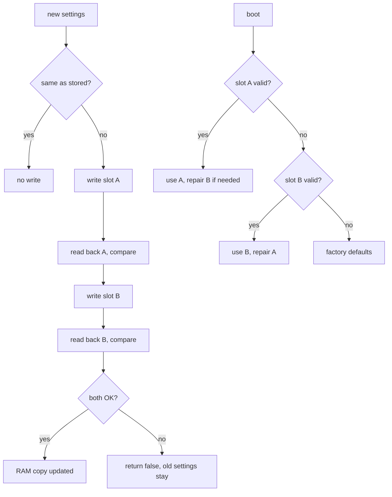

NVS writes a new entry before it invalidates the old one, so a reset during a write leaves the old or the new value. The two slots with CRC32 and the read-back are an extra check on top of that.

### I2Wifi

One task (`wifiTask`) handles the WiFi connection. The automatic reconnect of the WiFi library is switched off, so only this task reconnects.

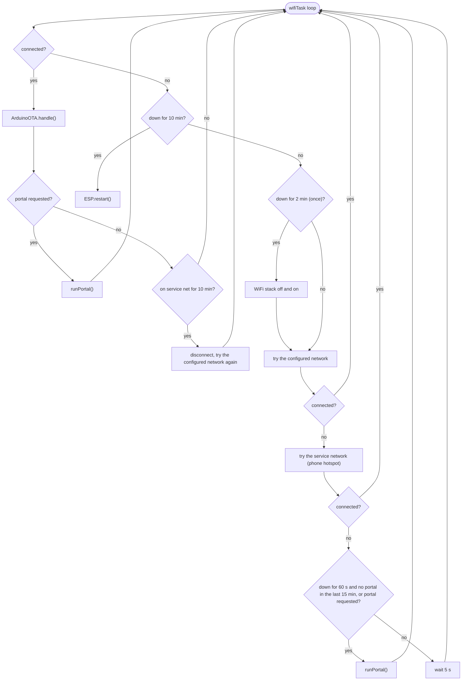

| Function | What it does |
|---|---|
| `connectTo(ssid, pass)` | one connection attempt, up to 20 s, gives up after 6 s if the SSID is not found or the password is wrong |
| `runPortal()` | opens the access point and the web page, checks the access code, saves the settings |
| `otaSetup()`, `otaStart()` | ArduinoOTA (hostname, password, progress), restarted after every new connection |
| `i2wifiRequestPortal()` | asks the task to open the portal (console command `portal`) |
| `g_i2OtaPercent` | OTA progress for the display (-1 idle, 0 to 100, -2 error) |

#### Configuration portal and access code

The portal is the WiFiManager page. The ESP32 opens its own access point `AqsAP-WiFi` (WPA2, password in `i2_secrets.h`), the phone connects and gets a page (192.168.4.1) with the network list, the password field, channel ID, API key, fast mode and the access code.

The portal opens only after the link was down for more than 60 s (at most once every 15 minutes) or when `portal` is typed on the console. It closes after 3 minutes.

The access code is the same code as for `login` on the serial console. The default is in `i2_secrets.h` and `passwd` changes it. Without the right code nothing is saved:

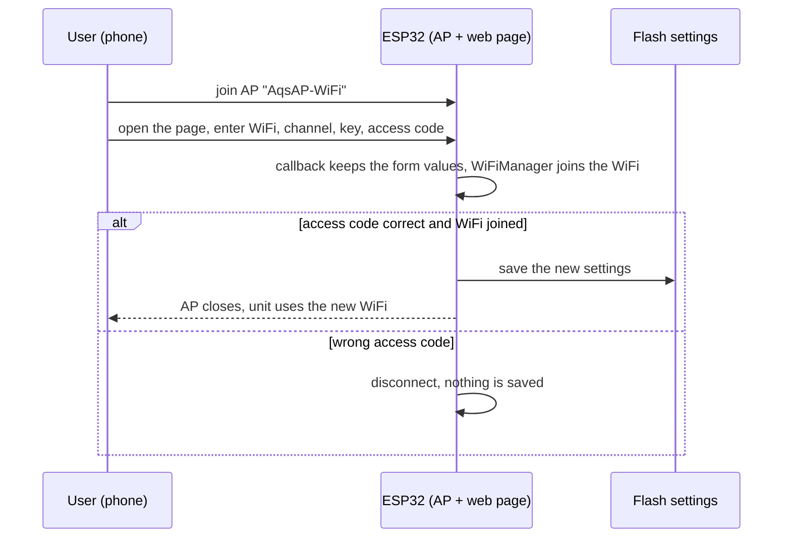

### I2Console

Serial command line (115200 baud).

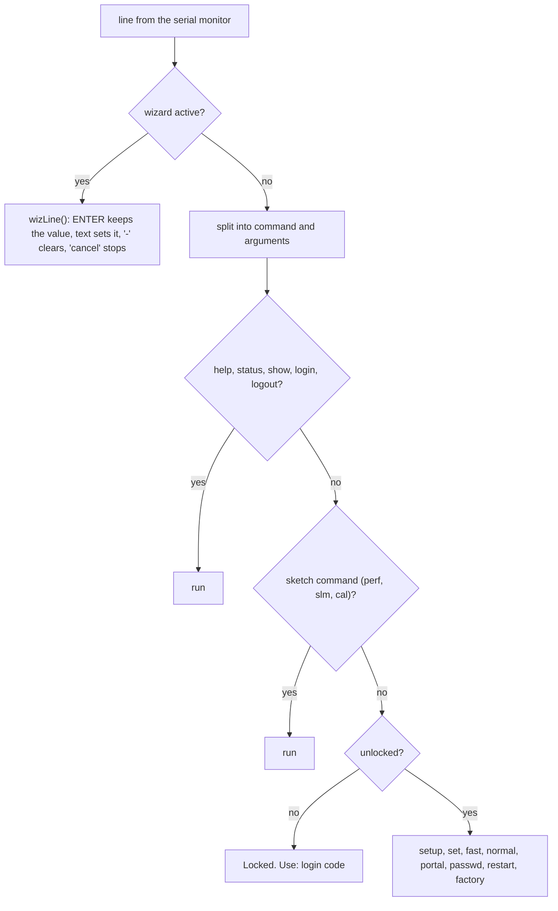

- One table (`FIELDS[]`) describes all settings and is used by `show`, `set` and the wizard.
- `login` unlocks for 5 minutes. Three wrong codes lock it for 30 s.
- The wizard shows the current value of every setting. At the end it asks "Save and restart?".
- Line endings CR, LF and CRLF are all accepted.

### I2Perf

| Tool | How it works |
|---|---|
| `PerfProbe`, `perfRecord`, `PerfScope` | microsecond timing of a code section: count, last, min, average, max and the number of times a budget was exceeded |
| `PerfCounter` | event counter (dropped queue items, failed uploads) |
| CPU load | the idle hook counts how often the idle task runs. At boot this is measured on an idle system. Load = 1 - idle rate / idle rate at boot. A 1 s sampler keeps the current, average and peak value |
| task table | priority, state and the smallest free stack of every task |
| heap | free, lowest ever, largest block |
| `perfLoadStart` | a task that uses a given percentage of a core |

### Watchdogs

The ESP32 has watchdog timers in the chip, so no external circuit is used.

- **Task watchdog.** `i2WdtInit(10)` sets a timeout of 10 s and makes a timeout reset the chip. The idle task of every core is watched, so a task that never blocks is detected. The state machine of the sensor unit and the display task of the matrix unit register with `i2WdtAddSelf()` and call `i2WdtFeed()` in every loop.
- **Interrupt watchdog and RTC watchdog.** They are normally active in the Arduino-ESP32 build.
- **Brownout detector.** It resets the chip when the supply voltage drops too far.

The `status` command shows the reset reason (power-on, software, panic, task watchdog, interrupt watchdog, brownout, external reset).

---

## Sensor unit (PMS_Sensor_RTOS)

### Files

| File | Content |
|---|---|
| `PMS_Sensor_RTOS.ino` | setup and task creation |
| `app_config.h` | all constants: pins, timing, priorities, feature switches, default calibration |
| `app_state.*` | shared data, probes |
| `pms5003t.*` | frame parser |
| `task_pms.cpp` | state machine |
| `task_thingspeak.cpp` | upload, retries, remote calibration |
| `sound_level.*`, `sos-iir-filter.h` | sound level meter |
| `task_display.cpp`, `task_misc.cpp` | OLED, status LED |
| `sensor_console.cpp` | commands `perf`, `slm`, `cal` |

`TEST_SINGLE_CORE 1` in `app_config.h` puts all tasks on core 0, which is how the single-core ESP32-S2 behaves.

### Start-up

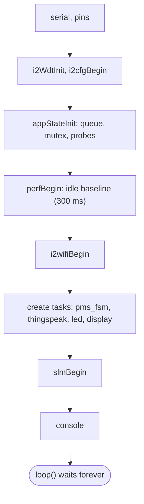

### Frame parser (pms5003t)

`PmsParser::feed()` gets every received byte. It looks for the start bytes `0x42 0x4D`, collects 32 bytes, checks the length (28) and the checksum and returns PM2.5, PM10 (atmospheric or CF=1, `PMS_USE_ATMOSPHERIC`), temperature and humidity (both divided by 10). A bad frame only increments a counter and the parser looks for the next start. The values are raw, the calibration is applied in `task_pms.cpp`.

### State machine (task_pms.cpp)

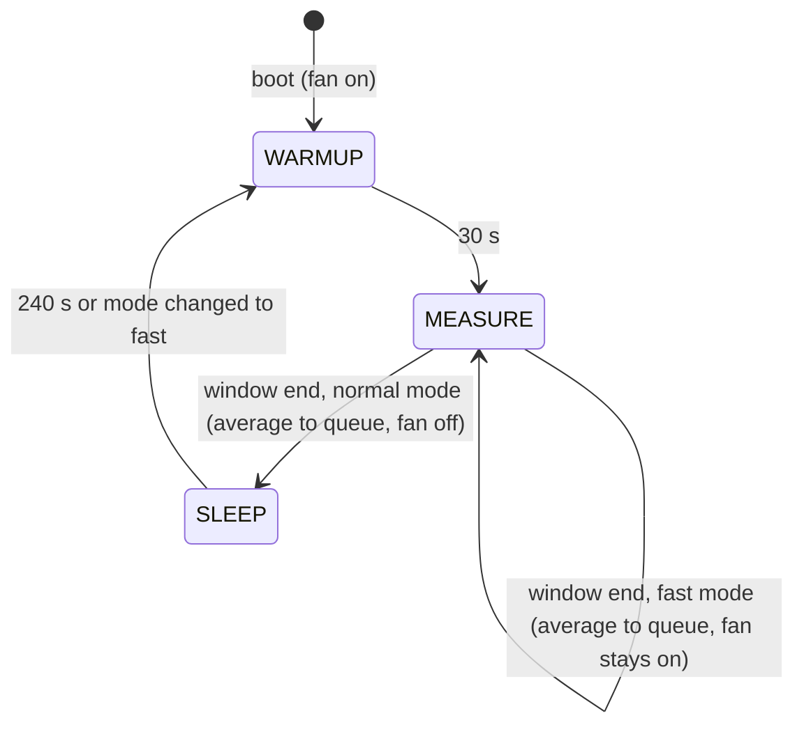

Every 50 ms the task:

1. waits on its notification with a 50 ms timeout (this is the loop delay, and it ends early when the settings change);
2. increments the heartbeat and feeds the watchdog;
3. reads the mode and the sleep time;
4. reads the UART unless the sensor sleeps. In MEASURE every valid frame is calibrated (`gain * raw + offset`), added to the sums and stored as the latest sample;
5. runs the state logic. At the end of a MEASURE window `finishWindow()` calculates the averages, adds the sound values from `slmTakeWindow()` and puts the message into the queue.

A normal cycle is 30 s + 30 s + 240 s = 300 s, which is one ThingSpeak update every 5 minutes. In fast mode the sleep is skipped and an update is sent every 60 s.

### Upload task (task_thingspeak.cpp)

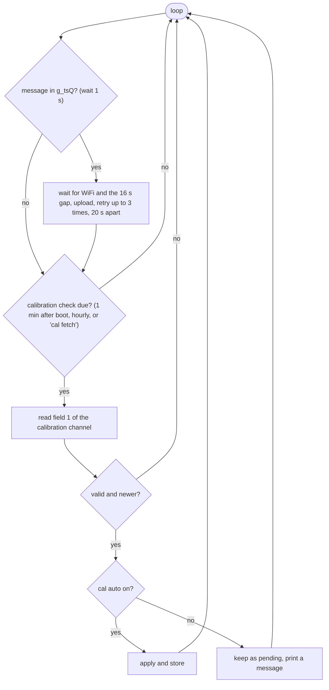

Fields of the data channel: 1 PM2.5, 2 PM10, 3 temperature, 4 humidity, 5 LAeq, 6 LAmax.
The calibration channel has one text field, for example `3,1.05,-1.2,1.02,0,1,-0.5,1,2` (version, then gain and offset for PM2.5, PM10, temperature, humidity). With `cal` the active and pending values are shown, `cal accept` / `cal reject` decide.

### Sound level meter (sound_level.cpp)

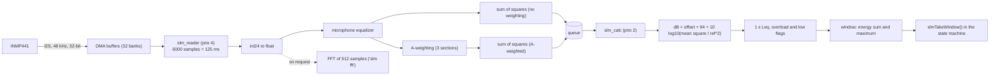

- The reader only converts, filters and sums, because it has a hard deadline. Logarithms, flags and the FFT are done in `slm_calc`.
- `10*log10(mean square)` is the same as `20*log10(RMS)`.
- Levels are averaged as energy (`10^(L/10)`), not as dB values. Seconds above the overload level (120 dB) are left out and counted.
- The filters are the INMP441 equalizer and the A-weighting from the esp32-i2s-slm project (Ivan Kostoski, GPL-3.0). On the classic ESP32 `sos-iir-filter.h` uses the assembly routine, on other chips plain C++.
- `slm fft` prints the spectrum between `START` and `END` lines, which is the format `inmp441.py` reads. The bin width is 93.75 Hz.
- The I2S channel is set with `SLM_I2S_CHANNEL`. With the L/R pin on GND the right channel works on the Arduino-ESP32 version used here.
- Probes: `slm_block` (budget 125000 us), `slm_calc`, `slm_fft`. Counter: `slm_block_dropped`.

### Commands

| Command | Login | Function |
|---|---|---|
| `help`, `status`, `show` | no | commands, state, settings (secrets masked) |
| `login <code>`, `logout` | - | unlock / lock |
| `setup` | yes | wizard |
| `set <key> <value>` | yes | change one setting |
| `fast`, `normal` | yes | measuring mode |
| `portal` | yes | open the config access point |
| `passwd`, `restart`, `factory yes` | yes | change the code, reboot, factory values |
| `cal`, `cal fetch` | no | show calibration, check the channel now |
| `cal accept`, `cal reject`, `cal auto on/off` | yes | calibration decisions |
| `perf`, `perf reset`, `perf cpu on/off`, `perf load ...` | no | timing tools |
| `slm`, `slm on/off`, `slm fft`, `slm raw` | no | sound level meter |
| `slm ref <dB>` | yes | calibrate with a known source |

---

## Matrix unit (Matrix_Display_RTOS)

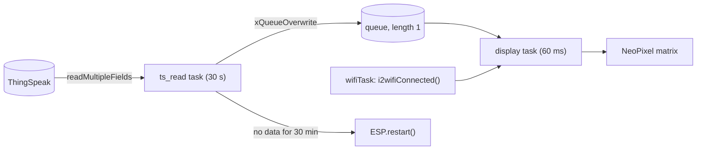

- `ts_read` reads all fields in one request, rounds the values and puts them into the queue. After a failed read it tries again after 10 s.
- `display` scrolls the text. New data is shown after the current message has scrolled out. While WiFi is down it shows "Connecting..".
- The old version called `WiFi.reconnect()` in a loop and could stay on "Connecting..". The WiFi task in the library now starts new connection attempts, uses the service network and resets the WiFi stack and the chip if the link stays down.
- Colours: PM2.5 below 35 green, below 53 yellow, below 70 orange, otherwise red. PM10: 50 / 75 / 100. Temperature: below 10 blue, below 20 yellow, below 30 orange, otherwise red. Humidity: below 30 lime, below 60 yellow, otherwise orange. Noise: 55 / 70 / 85.
- `MATRIX_W` is 16 for the test panel and 64 for the final display.

---

## Typical procedures

### Calibration after a sensor replacement

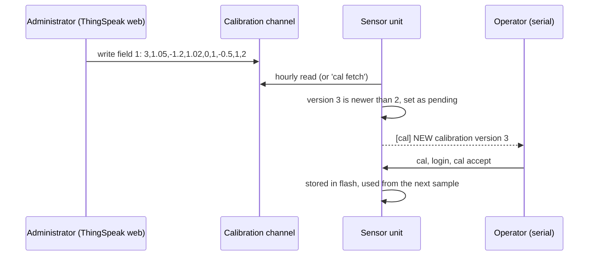

### Changing settings

| Way | When | Access code |
|---|---|---|
| serial `setup` or `set` | cable connected | yes (`login`) |
| config portal | WiFi lost or `portal` | yes (field on the page) |
| calibration channel | calibration only | confirmation with `cal accept` unless `cal auto on` |
| OTA | firmware update | OTA password |

---

## Testing

### Bench set-up

| Item | Connection |
|---|---|
| ESP32 board (sensor unit) | USB, Serial Monitor 115200 baud, line ending Newline |
| PMS5003T | PMS TX to GPIO16, PMS RX to GPIO17, SET to GPIO4, 5 V and GND |
| OLED SSD1306 | SDA GPIO21, SCL GPIO22, 3.3 V, address 0x3C |
| INMP441 (optional) | VDD 3.3 V, GND, SCK to GPIO32, WS to GPIO5, SD to GPIO33, L/R to GND |
| second ESP32 (matrix unit) | DIN to GPIO5 of that board, matrix on a suitable 5 V supply |
| phone | hotspot, config portal, sound level reference app |
| ThingSpeak | data channel (fields 1 to 6), optionally a second channel for calibration |

Preparation:

1. Install the libraries: ThingSpeak, WiFiManager, Adafruit SSD1306, Adafruit GFX, Adafruit NeoMatrix, Adafruit NeoPixel, arduinoFFT.
2. Copy `libraries/I2Common` to the Arduino `libraries` folder (or use the repository as the sketchbook folder).
3. Edit `libraries/I2Common/src/i2_secrets.h` (WiFi, service hotspot, OTA password, access code) and the ThingSpeak channel and keys in the two `app_config.h` files.
4. Board: ESP32 Dev Module, default partition scheme.
5. For the first tests log in and set a short sleep time: `login <code>`, `set sleep 30`.

Useful during all tests: `help`, `status`, `show`, `perf`.

### Test list

| # | Test | Steps | Expected result |
|---|---|---|---|
| 1 | Boot | flash the sensor sketch, open the monitor | factory defaults message on the first boot, `[perf] idle baseline`, WiFi connected, `Setup done`. `status` shows firmware, uptime, reset reason, WiFi, state |
| 2 | Console lock | `set channel 3095045` | `Locked. Use: login <code>` |
| 3 | Login and checks | `login <code>`, `set channel 12345`, `set channel 123456`, `set wkey ABC` | 5 digits rejected, 6 digits accepted, short key rejected |
| 4 | Setup wizard | `setup`, ENTER for every question, `y` at the end | current values shown, nothing changes, unit restarts |
| 5 | Persistence | change a value with `set`, press RESET, `show` | the value is still there, `status` says settings from flash: yes |
| 6 | Wrong code | `login wrong` three times | 30 s lockout message |
| 7 | State machine | watch the log | WARMUP 30 s, MEASURE 30 s with one sample per second, average, SLEEP, WARMUP |
| 8 | Sensor reaction | blow smoke or breath at the PMS during MEASURE | PM values rise, OLED follows, humidity rises with breath |
| 9 | Fast mode | `fast` while in SLEEP | sleep ends at once, MEASURE repeats every 60 s without sleep, LED blinks every 250 ms |
| 10 | Back to normal | `normal` | after the current window the unit sleeps again, LED 500 ms |
| 11 | Upload | wait for one average | `[ts] upload OK`, values in fields 1 to 4 (5 and 6 with the microphone) |
| 12 | Upload failure | `set wkey AAAAAAAAAAAAAAAA` (wrong key) | `upload failed, HTTP ...`, three tries 20 s apart, then `giving up`, counter `ts_upload_failed` increases. Restore the real key |
| 13 | Sensor unplugged | disconnect the PMS TX wire | `no valid frames in this window`, counter `pms_empty_windows` |
| 14 | WiFi loss | switch the router off | `link lost`, repeated attempts, reconnects when the router is back |
| 15 | Service network | phone hotspot with the service SSID and password, router off | the unit joins the hotspot, `status` shows SERVICE net |
| 16 | Config portal | no network for more than 60 s, or `portal` | AP `AqsAP-WiFi` appears, open `192.168.4.1` on the phone |
| 17 | Portal access code | submit the form once with a wrong and once with the right code | wrong: `WRONG access code - nothing saved`. Right: `settings saved` and the unit uses the new WiFi |
| 18 | Long outage | no network for more than 10 minutes | `down too long - restarting ESP32`, the unit starts again and keeps trying |
| 19 | OTA | choose the network port in the Arduino IDE and upload | progress bar on the OLED, the unit reboots, a wrong OTA password is refused |
| 20 | Calibration | see below | pending message, accept, values change |
| 21 | Matrix unit | see below | scrolling coloured text |
| 22 | Sound level | see below | LAeq follows the room noise |
| 23 | Performance | see below | timing table, CPU load, stack and heap |

### Remote calibration test

1. Create a second ThingSpeak channel and note its ID, read key and write key.
2. On the unit: `login <code>`, `set cfgch <channel id>`, `set cfgkey <read key>` (`-` for a public channel).
3. Write a calibration set from a browser (format `version,g25,o25,g10,o10,gT,oT,gH,oH`):
   `https://api.thingspeak.com/update?api_key=<WRITE_KEY>&field1=2,1.10,0,1.00,0,1,-1.5,1,3`
4. Type `cal fetch`. Expected: `NEW calibration version 2 available`.
5. `cal` shows the active and the pending values. `cal accept` stores them (login needed). From the next sample PM2.5 is 10 % higher, the temperature 1.5 lower and the humidity 3 higher.
6. A new version 3 with `cal reject` is refused and not offered again until version 4.
7. With `cal auto on` a new version is applied without asking.
8. An older version, or a broken string (for example gain 50), is ignored with a message.

### Matrix unit test

1. Flash `Matrix_Display_RTOS` to the second ESP32 and set the channel and read key: `login <code>`, `set channel ...`, `set rkey ...`.
2. Expected: `Connecting..` while WiFi is down, then the scrolling message `KHIE @ FEIT Vozduh: T:..C H:..% PM2.5:.. PM10:..`.
3. To check the colours write values by URL: `...update?api_key=<WRITE_KEY>&field1=80&field2=120&field3=35&field4=70&field5=90`. PM2.5, PM10, temperature and noise should be red, humidity orange.
4. New data that arrives during a scroll is shown after the message has ended.
5. Switch the router off for a few minutes and on again. The text must come back without a manual reset. After 10 minutes without WiFi the unit restarts itself.
6. `perf` shows `matrix_frame` (against the 60 ms scroll step) and `ts_read_http`.

### Sound level meter test

1. Wire the INMP441. `slm` must show `running` and a changing LAeq. If the level stays at the minimum, type `slm raw`. All zeros means the wrong I2S channel (`SLM_I2S_CHANNEL` in `app_config.h`) or a wiring problem.
2. Typical values indoors: quiet room 30 - 45 dBA, speech 55 - 65 dBA, a clap above 80 dBA.
3. Compare with a sound level app on a phone (phone microphones are not accurate).
4. For a proper calibration put a 94 dB / 1 kHz calibrator on the microphone and type `slm ref 94` (login needed). The offset is stored in flash (`set slmoff` sets it directly).
5. `slm fft` prints one spectrum, `inmp441.py` can plot it (bin width 48000 / 512 = 93.75 Hz).
6. `slm off` and `slm on` stop and start the microphone processing. The sensor cycle must continue unchanged.

### Performance test

For every configuration: `perf reset`, `perf cpu on`, wait 60 s, `perf`. Read the CPU load per core (current, average, peak), the probe table (`slm_block`, `slm_calc`, `pms_loop_body`, `pms_wake_late`, `oled_frame`, `ts_http`), the free stack of the tasks and the heap line.

| Configuration | How |
|---|---|
| A: sensor only | `ENABLE_SLM 0` |
| B: sensor and sound level meter, two cores | defaults |
| C: sensor and sound level meter, one core (like the S2) | `TEST_SINGLE_CORE 1` |

Overload test: `perf load <pct> <prio> <core> <seconds>` with 30, 50, 70 and 90 % at priority 1 and at priority 5 on the core of the sound level meter, then `perf` after every step.

| Observation | Meaning |
|---|---|
| `slm_block` maximum below 125000 us | the filtering finishes within one block |
| `slm_block` overruns above 0 | a deadline was missed, the I2S buffers can overflow |
| `slm_block_dropped` above 0 | `slm_calc` is too slow, data was lost |
| `pms_wake_late` maximum grows | the state machine is delayed by other tasks |
| free stack below 300 bytes | the stack of that task is too small |
| WiFi drops at high load | the load task starves the network task |

### Before a unit goes to a school

- `normal` mode and sleep time 240 s (`show`). Fast mode is stored in flash and survives a reset.
- Access code, OTA password and portal password changed from the factory values.
- `status`: WiFi connected, upload OK, no pending calibration, reset reason power-on.
- `ENABLE_SLM 0` if no microphone is fitted, `ENABLE_OLED 0` if there is no OLED.
- The real `i2_secrets.h` is not committed.

### Troubleshooting

| Symptom | Check |
|---|---|
| `no valid frames` | TX/RX swapped, SET pin, 5 V supply of the PMS, 9600 baud |
| PM values look wrong | frame offsets, atmospheric or CF=1 (`PMS_USE_ATMOSPHERIC`) |
| OLED stays black | address (0x3C or 0x3D), wiring, `oled init failed` message |
| no network port for OTA | unit and PC on the same network, firewall, OTA password |
| LAeq constant or minimum | `slm raw`, microphone wiring, L/R pin, `SLM_I2S_CHANNEL` |
| console ignores input | line ending must be Newline or Both NL & CR |
| portal does not save | WiFiManager version, access code typed correctly |

---

## Design notes

**Why FreeRTOS?** In a super-loop each action waits for the previous one, so a slow HTTP request delays the sensor reading and the display. With tasks each job has its own period and priority, and the scheduler interrupts a low-priority task when a high-priority one is ready. Timing can be measured per task.

**Why NVS instead of EEPROM?** NVS is wear-levelled and checks every entry. The settings are also stored twice with a CRC and verified after writing.

**What happens on a reset during a flash write?** NVS keeps the old entry until the new one is complete. The block is written in two slots, both are verified, and at boot the first valid slot is used, otherwise the factory defaults. The brownout detector resets the chip before the supply gets too low, and `status` shows the reset reason.

**Why a portal and a serial console?** The portal changes the WiFi on site with a phone, the console is for installation and testing. Both use the same access code. The access point is closed in normal operation, opens only when the link is lost or on command, closes after 3 minutes, and nothing is saved without the code.

**Service network.** A phone hotspot with a fixed name and password. Firmware can be updated over the air even if the school network is not available.

**Normal and fast mode.** Normal: 30 s warm-up, 30 s measuring, 240 s sleep with the fan off, one upload every 5 minutes. Fast: no sleep, an upload every 60 s. Fast mode is for tests and demonstrations.

**Calibration.** The coefficients are stored in flash, so replacing a sensor does not need a new firmware. They can be updated through the calibration channel and are applied after confirmation, or automatically if `cal auto` is on.

**10 log10 or 20 log10.** `20*log10(RMS)` and `10*log10(mean square)` give the same result, the second one saves a square root.

**ESP32-S2.** It has one core and no floating-point unit, so the filter chain runs in software. Configuration C in the performance test shows how much time it needs.

**FreeRTOS load tools.** Stack high-water mark per task, run-time statistics (need a special build option) and the idle-hook method used here. Outside the firmware SEGGER SystemView, Percepio Tracealyzer, or a GPIO pin toggled around the critical code and watched with a logic analyser can be used.
