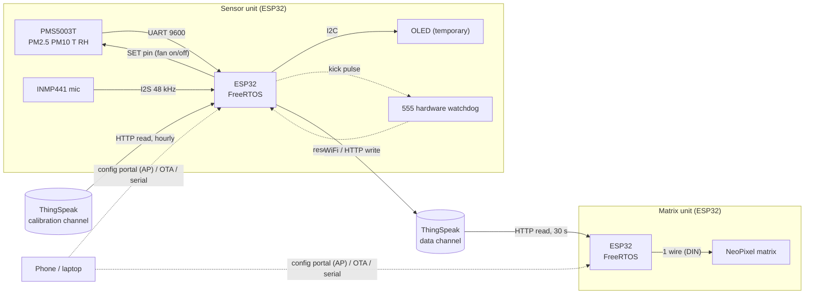
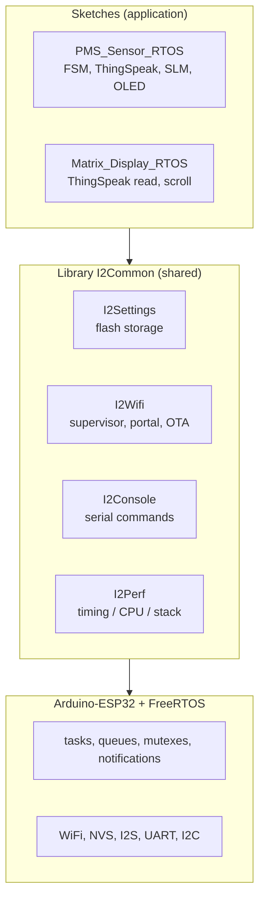
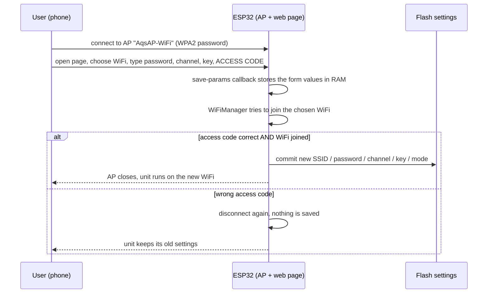
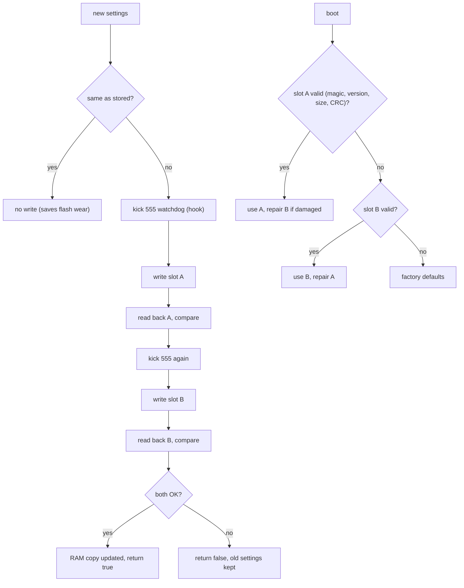
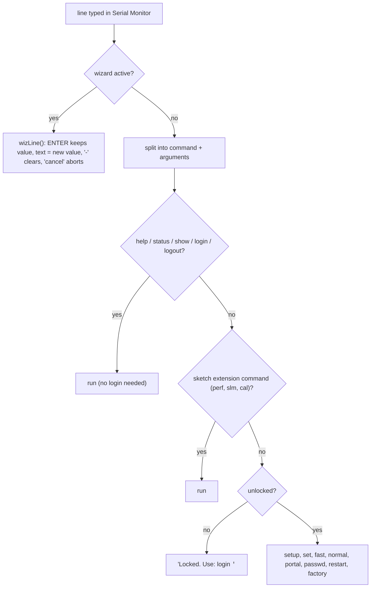
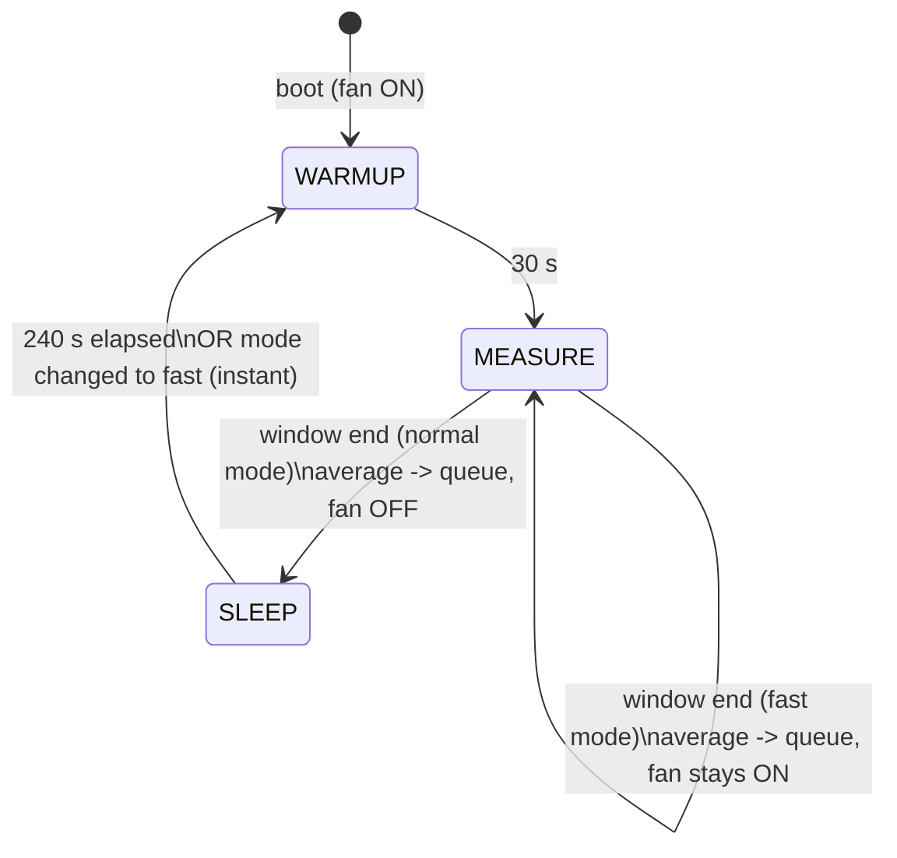
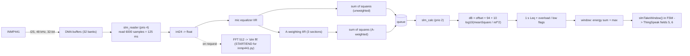
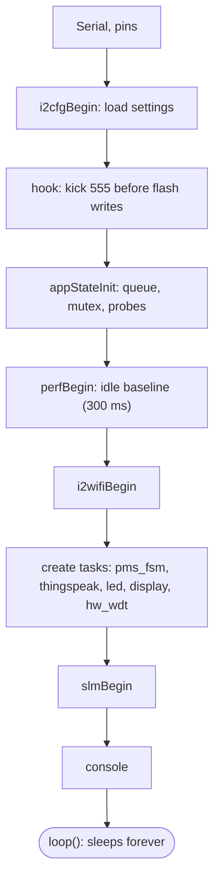
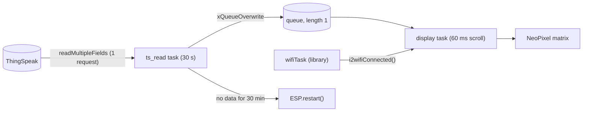
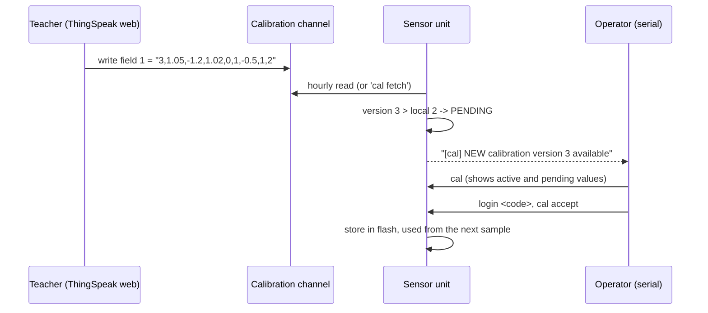

# I2 Air-Quality Project - code explained (for documentation and comments)

Folder: `FilipCode/7-07noemvri-Filip/`

- `libraries/I2Common/` - shared library (settings, WiFi, console, timing tools)
- `PMS_Sensor_RTOS/` - sensor unit (PMS5003T + INMP441 sound level meter + OLED)
- `Matrix_Display_RTOS/` - matrix display unit

Diagrams are Mermaid (they render in the VS Code Markdown preview; export to PNG/SVG for Word).

---

## 1. The big picture

### 1.1 System block diagram

### 1.2 Software layers

### 1.3 Tasks (the RTOS design)

Higher priority number = more urgent. Task stack sizes are in bytes.

| Task | Unit | Priority | Core (ESP32) | Period / trigger | Job |
|---|---|---|---|---|---|
| `slm_reader` | sensor | 4 | 1 | every 125 ms (I2S block) | read mic block, filter, produce 2 sums |
| `pms_fsm` | sensor | 3 | 0 | 50 ms | state machine + UART parsing |
| `hw_wdt` | sensor | 3 | 0 | 1 s | kick 555 while FSM is alive (only if pin set) |
| `thingspeak` | sensor | 2 | 0 | queue / 1 s poll | upload, retries, calibration check |
| `slm_calc` | sensor | 2 | 1 | per block | dB, Leq, FFT |
| `wifiTask` | both | 2 | 0 | 100 ms | connection supervisor, OTA, portal |
| `display` | sensor | 1 | 0 | 250 ms | OLED |
| `led` | sensor | 1 | 0 | 250 / 500 ms | status LED |
| `console` | both | 1 | 0 | 50 ms | serial commands |
| `perfSampler` | both (on demand) | 5 | any | 1 s | CPU-load sampling |
| `ts_read` | matrix | 2 | 0 | 30 s | read ThingSpeak |
| `display` | matrix | 3 | 1 | 60 ms | scrolling text |

Design rule (rate-monotonic idea): the most time-critical work gets the highest priority. The I2S block must never be late, so it is highest. The ThingSpeak HTTP request blocks for seconds, so it is below the FSM.

### 1.4 How tasks talk to each other (RTOS objects used)

| Object | Where | Why |
|---|---|---|
| **Queue** `g_tsQ` (length 4) | FSM -> thingspeak task | the FSM never waits for the network |
| **Queue** `s_q` (length 8) | slm_reader -> slm_calc | decouples fast filtering from the dB maths |
| **Queue** `s_dataQ` (length 1, `xQueueOverwrite`) | matrix ts_read -> display | the display always gets the newest reading |
| **Mutex** | latest sample, settings, SLM window | protect data that two tasks touch |
| **Task notification** | settings changed -> FSM | wakes a sleeping task without polling |
| **volatile flags** | state, heartbeat, OTA percent | simple one-writer / many-reader values |

---

## 2. Your question: what is the "Access Code" and which "portal page"?

### 2.1 Which portal page

This is the **WiFiManager configuration page** from your original code. It is a small web page that the ESP32 itself serves while it runs its own WiFi access point (AP).

How you get to it:
1. The ESP32 starts an access point named **`AqsAP-WiFi`** (password `FEIT_KHIE_AP`).
2. You connect your phone to that WiFi network.
3. The phone opens the page automatically (captive portal), or you open `192.168.4.1` in a browser.
4. The page shows a list of nearby networks, a password box, and the extra fields from the original code (ThingSpeak channel ID, write/read key, fast-mode checkbox).

Now the ESP32 opens this AP only when it is needed:
- **Automatically**: the unit has been without WiFi for more than 60 s (at most once per 15 minutes).
- **On demand**: you type `portal` in the serial monitor (after `login`).
- It stays open for **3 minutes**, then closes by itself.

### 2.2 What the Access Code is

The access code is the **"general password"** from your 28.10 comments ("so that not just anyone can get in and set parameters").

- It is the same code as the serial `login <code>` code. Factory default is `KHIE-2026` (in `i2_secrets.h`). It is stored in flash and changed with the serial command `passwd`.
- It is an extra field at the top of the portal page: **"Access code (required)"**.
- A person who only knows the AP password could connect to the AP, but **cannot change anything** without the access code.

What the code does on the portal (function `runPortal()` in `I2Wifi.cpp`):

Protection layers (this answers the "someone connected to the AP and entered wrong data" case):
1. The AP is closed during normal operation.
2. The AP is WPA2-protected and closes after 3 minutes.
3. Nothing is stored without the correct access code.

**To verify on hardware:** that your WiFiManager version calls the save-params callback when the main WiFi form is submitted (it did in your original code, which used the same callback). If it does not, the portal would join the WiFi but not save anything.

---

## 3. Library `I2Common` (shared by both sketches)

### 3.1 `i2_secrets.h` - factory values (needed)

Plain `#define`s: default WiFi (`I2_DEFAULT_WIFI_*`), service/hotspot WiFi (`I2_SERVICE_WIFI_*`), portal AP name + password (`I2_AP_*`), OTA password, default access code. They are used only until you change them from the console/portal. Never publish this file.

### 3.2 `I2Task.h` - core helper (needed)

- `I2_NUM_CORES` is 2 on the ESP32 and 1 on S2/C3.
- `i2Core(core)` returns a valid core: on single-core chips always 0. This is why the same code runs on the ESP32 NodeMCU and the ESP32-S2 mini.
- Declares `i2CreateTask(fn, name, stackBytes, arg, priority, handleOut, core)`: creates a pinned task and registers it for the `perf` report.

### 3.3 `I2Settings.h/.cpp` - settings in flash (needed)

**Why:** replaces the EEPROM code. Survives reset/power-loss better and can hold many values.

**The struct `I2Settings`** (one block in flash):

| Field | Meaning |
|---|---|
| `magic`, `version`, `size`, `crc` | detect an empty / old / damaged block |
| `ssid`, `wifiPass` | configured WiFi |
| `channelId` | ThingSpeak channel (stored as a number, 6-8 digits accepted) |
| `writeKey` / `readKey` | sensor writes / matrix reads |
| `cfgChannelId`, `cfgReadKey` | optional calibration channel |
| `accessCode` | the access code (serial + portal) |
| `fastMode`, `sleepSec` | measuring mode and sleep time |
| `calAuto`, `calVersion`, `pm25/pm10/temp/humid` | calibration (gain, offset) and version in use |
| `slmOffsetDb` | microphone calibration offset |

**`I2Defaults`** - factory values handed in by the sketch (a library `.cpp` cannot see macros of the sketch).

**Functions**

| Function | What it does |
|---|---|
| `i2cfgBegin(defaults)` | opens flash storage, reads slot A and slot B, picks the first valid, repairs a damaged one, or writes factory defaults on first boot |
| `i2cfgSnapshot(out)` | thread-safe copy of the settings (take a copy, read from the copy) |
| `i2cfgCommit(new)` | stamp magic/version/size/CRC, skip if nothing changed, write slot A, read back and compare, write slot B, read back and compare |
| `i2cfgFactoryReset()` | commit the factory defaults |
| `i2cfgSetPreWriteHook(fn)` | function called right before each flash write (used to kick the 555) |
| `i2cfgFastMode/SleepSec/SlmOffsetDb/GetCal` | fast getters for values the tasks read often |
| `i2cfgApplyCal(version, cal[4])` | store a new calibration set |
| `i2cfgCheckAccessCode(code)` | constant-time compare (used by the portal) |
| `i2ValidChannelId` | 6-8 digits, no leading zero |
| `i2ValidApiKey` | exactly 16 letters/digits |
| `i2CalParseCsv` | parses `version,g25,o25,g10,o10,gT,oT,gH,oH` and rejects insane values (gain 0.1..10, offset +-500) |
| `i2CalApply(c, raw)` | `gain * raw + offset` |

**Flash-write protection (item 4):**

Why it is safe: flash storage (NVS) writes a new entry and invalidates the old one afterwards, so a reset leaves the old or the new value. The two slots, CRC and read-back add a second line of defence. Total power loss cannot be made 100 % safe; this makes it very unlikely to end with garbage, and a damaged block always falls back to a good copy or the defaults.

### 3.4 `I2Wifi.h/.cpp` - WiFi supervisor, portal, OTA (needed)

One task (`wifiTask`) owns the whole WiFi connection. Other tasks only ask `i2wifiConnected()`.

| Function | What it does |
|---|---|
| `connectTo(ssid, pass)` | one attempt. Waits up to 20 s but gives up after 6 s if the status says "SSID not found" or "failed" (wrong password) |
| `runPortal()` | opens the AP + web page, collects the values, checks the access code, saves (see section 2) |
| `portalSaveCb()` | callback from WiFiManager: copies the submitted form values into RAM |
| `otaSetup()` / `otaStart()` | configures ArduinoOTA (hostname, password, progress callbacks) and (re)starts it after every new connection |
| `wifiTask()` | the loop in the flowchart above |
| `i2wifiBegin()` | sets WiFi options (no auto-reconnect, no power save, station mode) and creates the task |
| `i2wifiRequestPortal()` | sets a flag; the task opens the portal on its next pass |
| `i2wifiConnected / OnServiceNet / DownMs / PrintStatus` | status for other tasks and `status` command |
| `g_i2OtaPercent` | OTA progress (-1 idle, 0..100, -2 error) read by the display |

Why `WiFi.setAutoReconnect(false)`: the supervisor handles reconnection itself; two reconnect mechanisms would fight each other. That conflict is a likely cause of the old matrix "Connecting.." hang.

### 3.5 `I2Console.h/.cpp` - serial command line (needed for setup, optional for the rest)

Parts:
- **Field table `FIELDS[]`**: one row per setting (key, label, which units use it, secret or not). `show`, `set` and the wizard all use this one table, so a new setting is added in one place.
- **`fieldGet` / `fieldSet`**: print a value (secrets masked) / validate and store a new value.
- **Authentication**: `login` unlocks for 5 minutes; 3 wrong codes lock for 30 s; compare is constant-time.
- **Wizard**: `wizStart / wizNext / wizPrompt / wizLine`. Shows the current value for every setting; at the end a summary and "Save and restart? (y/N)".
- **Line reader `consoleTask`**: handles CR, LF and CRLF as one line end, backspace, 128-character limit, wizard timeout after 120 s.
- **`i2consoleBegin(ext, help, statusHook, changedHook)`**: the sketch plugs in its own commands, extra lines for `status`, and a function called after settings change.

### 3.6 `I2Perf.h/.cpp` - timing and load tools (needed for item 9)

| Tool | How it works | What it answers |
|---|---|---|
| `PerfProbe` + `perfRecord` / `PerfScope` | measures a code section with the microsecond timer; keeps count, last, min, max, total, and counts runs longer than a budget | "How long does the FFT / filter block / HTTP take?" (max = worst case) |
| `PerfCounter` | simple event counter | "How many blocks were dropped? How many uploads failed?" |
| CPU load (`perfBegin`, `perfCpuEnable`) | counts how often the idle task runs (idle hook). At boot it measures the idle rate = 0 % load; later load = 1 - rate/baseline. A 1 s sampler keeps current, average and peak | "How busy is each core?" |
| task table | `uxTaskGetStackHighWaterMark` = smallest free stack ever | "Is a stack close to overflowing?" |
| heap | free, minimum ever free, largest block | "Is memory running out?" |
| `perfLoadStart` | a task that burns pct % of a core in 100 ms periods | "At what load does the system start missing deadlines?" |
| `i2CreateTask` | creates and registers tasks | needed for the task table |

---

## 4. Sensor sketch `PMS_Sensor_RTOS/`

### 4.1 `app_config.h` - all constants (needed)

Feature switches (`ENABLE_SLM`, `SLM_ENABLE_FFT`, `ENABLE_OLED`, `TEST_SINGLE_CORE`), pins, 555 watchdog pin (`-1` = not used), FSM times (`PMS_WARMUP_MS` 30 s, `PMS_MEASURE_MS` 30 s, `PMS_SLEEP_DEFAULT_S` 240, `PMS_FAST_WINDOW_MS` 60 s), LED periods (250 / 500 ms), ThingSpeak limits, priorities, core assignment, default calibration, default channel.

`TEST_SINGLE_CORE 1` puts every task on core 0 so the ESP32 NodeMCU behaves like the single-core S2 mini - used for the load experiments.

### 4.2 `app_state.h/.cpp` - shared data (needed)

- `PmsSample` (calibrated values), `TsMsg` (average + sound values sent to the upload task).
- Globals: `g_pmsState`, `g_stateStartMs`, `g_stateDurMs` (for "seconds left" on the OLED), `g_pmsHeartbeat` (FSM alive counter), `g_tsQ`, `g_tsLastStatus`, `g_tsLastOkMs`.
- `appLatestSet/Get`: the most recent sample behind a mutex (OLED reads it).
- Probes and counters for the perf report.
- `hwWdtKick()`: pulse the 555 input (does nothing if the pin is `-1`).

### 4.3 `pms5003t.h/.cpp` - frame parser (needed)

`PmsParser::feed(byte)` is called for every received byte:
1. wait for `0x42`, then `0x4D`
2. collect 32 bytes
3. check frame length (28) and checksum (sum of first 30 bytes)
4. decode PM2.5, PM10 (atmospheric or CF=1, `PMS_USE_ATMOSPHERIC`), temperature (signed, /10), humidity (/10)

It never blocks. A bad frame only increments a counter and the parser re-synchronises.

### 4.4 `task_pms.cpp` - the state machine (needed)

Each loop (every 50 ms):
1. Wait on the task notification with a 50 ms timeout (this is both the loop delay and the wake-up on "settings changed"). The lateness of that wake-up is recorded as scheduling jitter.
2. Increment the heartbeat, feed the software watchdog.
3. Read the mode and sleep time (they may have changed).
4. Unless sleeping, read all UART bytes into the parser. In MEASURE each good frame is **calibrated** (`gain*x+offset`), added to the sums and stored as "latest".
5. State logic as in the diagram. At the end of a MEASURE window `finishWindow()` averages, adds the sound level window (`slmTakeWindow`), and puts a `TsMsg` in the queue (if full: count a drop).

Normal cycle = 30 + 30 + 240 = 300 s per upload.

### 4.5 `task_thingspeak.cpp` - network + remote calibration (needed)

ThingSpeak fields: 1 PM2.5, 2 PM10, 3 temperature, 4 humidity, 5 LAeq, 6 LAmax.
Calibration channel field 1 text: `version,g25,o25,g10,o10,gT,oT,gH,oH`, for example `2,1.05,-1.2,1.02,0,1,-0.5,1,2`.
Operator flow: `cal` (show active + pending) -> `cal accept` or `cal reject`.

### 4.6 `sound_level.h/.cpp` + `sos-iir-filter.h` - sound level meter (optional feature)

Key points:
- Why two tasks: the reader must keep up with the microphone (hard deadline every 125 ms) and does only filtering; logs and dB maths run in the lower priority task.
- `10*log10(mean square)` equals `20*log10(RMS)`: the same result, one square root less.
- Levels are averaged as **energy** (10^(L/10)), never by averaging dB values.
- Overload seconds (above 120 dB) are excluded from the upload average and counted.
- `sos-iir-filter.h`: Kostoski's filter. Assembly for the classic ESP32; plain C++ for other chips (S2 has no FPU, so it is slow there).
- Probes: `slm_block` (budget = 125000 us), `slm_calc`, `slm_fft`; counter `slm_block_dropped` (calc task not keeping up).

### 4.7 `task_display.cpp`, `task_misc.cpp`

- OLED task (temporary): state + seconds left, mode, PM, T/H, noise, WiFi/TS status, OTA progress bar. Frame time recorded as probe `oled_frame`.
- LED task: toggles every 250 ms (fast) / 500 ms (normal).
- `hw_wdt` task: kicks the 555 every `HW_WDT_PERIOD_MS` only if the FSM heartbeat advanced, so a frozen FSM stops the pulses and the 555 resets the ESP32.

### 4.8 `sensor_console.cpp` - sensor commands

`perf` (report, reset, cpu on/off, load), `slm` (status, on/off, fft, ref), `cal` (show, fetch, accept, reject, auto). Also adds FSM/ThingSpeak/SLM lines to `status` and wakes the FSM when settings change.

### 4.9 `PMS_Sensor_RTOS.ino` - start-up order

---

## 5. Matrix sketch `Matrix_Display_RTOS/`

- `ts_read`: reads fields 1-5 in one HTTP request, rounds to integers, puts them in the queue. On failure retries after 10 s and restarts the unit if nothing worked for 30 minutes.
- `display`: shows "Connecting.." while WiFi is down. When new data arrives while a message is scrolling, it waits until the message has scrolled out, then switches (your original idea). Text is drawn in coloured segments (colour by value); the message width is computed from the text actually drawn.
- Colour thresholds: unchanged from your code; noise added (<55 green, <70 yellow, <85 orange, else red).

---

## 6. Typical flows (for the report)

### 6.1 Calibration after a sensor replacement

### 6.2 Changing parameters

| Way | When | Needs access code |
|---|---|---|
| Serial `setup` wizard / `set key value` | cable connected | yes (`login`) |
| Config portal (AP page) | WiFi lost or `portal` command | yes (field on the page) |
| ThingSpeak calibration channel | calibration only | confirmation (`cal accept`) unless `cal auto on` |
| OTA | firmware update | OTA password |

---

## 7. What is needed and what is optional

| Part | Needed? | If removed |
|---|---|---|
| `I2Settings` | yes | no stored parameters |
| `I2Wifi` (supervisor + OTA) | yes | no connection management |
| config portal inside `I2Wifi` | optional (your choice) | serial setup + service network still work |
| service (hotspot) network | optional | one `if` block in `wifiTask` |
| `I2Console` | optional but recommended | no serial setup, no `perf` |
| `I2Perf` | needed for item 9 | no measurements (also remove probe calls) |
| `sound_level.*`, `sos-iir-filter.h` | optional (`ENABLE_SLM 0`) | PMS only |
| `task_display.cpp` | temporary | final product uses the matrix |
| 555 hook / `hw_wdt` | only if the 555 is wired | leave `PIN_HW_WDT_KICK -1` |

## 8. To verify on real hardware

1. PMS5003T frame offsets (temperature / humidity / PM type) against the old `PMS5003T.h`.
2. WiFiManager save callback saves the portal values (section 2).
3. Build with your installed library versions (ThingSpeak, arduinoFFT, Adafruit libraries, WiFiManager).
4. `perf` numbers on the NodeMCU (2 cores) and with `TEST_SINGLE_CORE 1` (S2-like).
